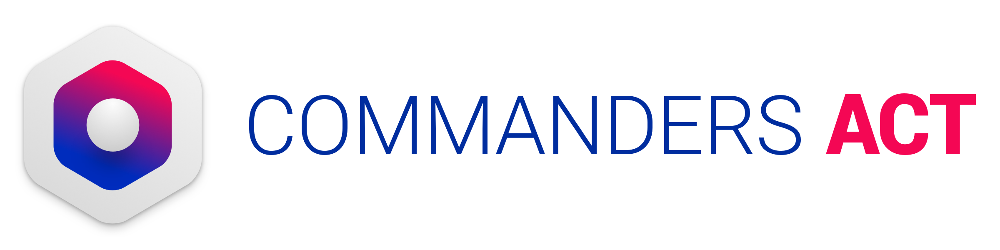
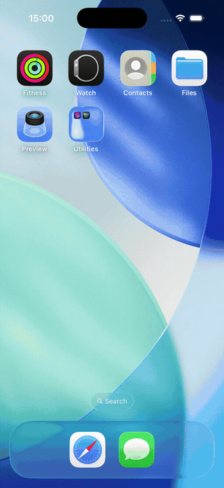

# TCDemoReactNative

Demo app for integrating CommandersAct's React Native bridges into a bare React Native app :

* [TCCore](https://github.com/CommandersAct/tccore-react-native)
* [TCServerSide](https://github.com/CommandersAct/tcserverside-react-native) — analytics/events SDK
* [TCConsent](https://github.com/CommandersAct/tcconsent-react-native) — consent management SDK

For full native details, see the native documentation:

* [Android](https://github.com/CommandersAct/Androidv5)
* [iOS](https://github.com/commandersact/iosv5)

<div align="center">
  
</div>

## App structure

A bottom tab navigator (`src/navigation/RootNavigator.tsx`) with four tabs:

* **Home** — shows whether each SDK finished initializing, live executed/sent event counters, and whether valid consent is currently saved.
* **Execute Events** — pick one of the prebuilt sample events (page view, login, purchase, refund, custom event, ... — see `src/data/demoEvents.ts`) and send it via `TCServerSide.execute`.
* **Collect Consent** — two ways to collect consent side by side for comparison: a plain app-level RN banner calling `acceptAllConsent`/`refuseAllConsent`/`showPrivacyCenter`, and CommandersAct's own native banner/Privacy Center (`showBanner`/`showPrivacyCenter`). Only use one of the two in a real app.
* **Consent Status** — lists currently accepted consent keys (`getAllAcceptedConsent`) and lets you reset consent (`resetSavedConsent`).

Every button in the app has a small "**?**" next to it — tap it to reveal the exact bridge function that button calls, so you never have to guess what's happening under the hood.

## IAB variant

The `iab` branch swaps `@commandersact/tcconsent-react-native-noiab` for `@commandersact/tcconsent-react-native`, mainly to show the IAB-capable Privacy Center. Some Consent functions are non-iab-only for now — the CommandersAct Banner (`showBanner`) is one of them, so on that branch its button on the Collect Consent tab is replaced with a note saying so instead of being wired up.

## Where to look in the code

A few call sites are all you need to find your way around the SDK integration itself:

* **SDK initialization** — [`src/context/CommandersActSDKInit.tsx:23`](src/context/CommandersActSDKInit.tsx#L23) (`TCServerSide.initServerSide`) and [`:31`](src/context/CommandersActSDKInit.tsx#L31) (`TCConsent.setSiteIDPrivacyID`).
* **Execute an event** — [`src/screens/ExecuteEventsScreen.tsx:32`](src/screens/ExecuteEventsScreen.tsx#L32) (`TCServerSide.execute`).
* **Show the Privacy Center** — [`src/screens/ConsentActionsScreen.tsx:51`](src/screens/ConsentActionsScreen.tsx#L51) (`TCConsent.showPrivacyCenter`), also used as the CommandersAct banner's tap-through callback at [`:39`](src/screens/ConsentActionsScreen.tsx#L39).
* **Show the CommandersAct native banner** — [`src/screens/ConsentActionsScreen.tsx:36`](src/screens/ConsentActionsScreen.tsx#L36) (`TCConsent.showBanner`).

Every other SDK call in the app (`acceptAllConsent`, `refuseAllConsent`, `resetSavedConsent`, `getAllAcceptedConsent`, `shouldDisplayPrivacyCenter`) sits right next to its screen's button — see [App structure](#app-structure) above, or just tap the "?" next to any button in the app itself.

## SDK initialization

Both SDKs are bootstrapped once for the whole app in `src/context/CommandersActSDKInit.tsx`, wrapping the navigator in `App.tsx`. It's two plain, sequential calls — `TCServerSide.initServerSide` first, then `TCConsent.setSiteIDPrivacyID`, since Consent's init immediately reads ServerSide's state:

```ts
// src/context/CommandersActSDKInit.tsx
export const SITE_ID = 1111;
export const PRIVACY_ID = 2222;
export const SOURCE_KEY = 'a_source_key';

await TCServerSide.initServerSide(SITE_ID, SOURCE_KEY);
await TCConsent.setSiteIDPrivacyID(SITE_ID, PRIVACY_ID);
```

Check with your consultant or your CommandersAct platform for the real `siteID`/`privacyID`/`sourceKey` values before using this outside of the demo.

The Home tab shows each of these two calls as its own status row (initialising vs initialised), read via the `useCommandersActSDKInit()` hook instead of screens calling the SDKs' init functions directly.

## Native helper module: TCBannerNavBar (Android)

On Android, the CommandersAct bottom banner sits in its own window and doesn't extend into the system navigation bar area — on an edge-to-edge screen that would leave a gap under the banner in the wrong color. `src/native/TCBannerNavBar.ts` paints that strip in the matching color for as long as the banner is showing (called right before `showBanner` in `ConsentActionsScreen.tsx`).

This isn't working around a bug in the SDK — it's a deliberate, safer choice: rather than have the SDK reach into and repaint the host app's window on your behalf, it stays scoped to its own banner window, and it's up to the integrating app to extend its own background under the system bar if it wants that edge-to-edge look. This demo shows one way to do that. No-op on iOS, which has no equivalent system navigation bar.

## Getting started

```sh
npm install
# iOS only
cd ios && bundle exec pod install && cd ..

npm run android
npm run ios
```

Keep an eye on Android Studio's Logcat, the Xcode console, or the React Native console for SDK debug logs while using the app. The CommandersAct platform samples hits server-side, so a missing hit there doesn't always mean it wasn't received — add a `test_code` additional property with a random value to an event to bypass sampling while testing.

The Home tab's "executed" / "sent" counters are produced by parsing the Xcode console (iOS) and Android Studio's Logcat (Android) for the SDK's own debug log lines — they're session-only and log-based, so treat them as a helpful indicator rather than an exact count; small inaccuracies are expected.

## Support & contact


Support: support@commandersact.com

http://www.commandersact.com

Commanders Act | 25 rue de Tolbiac - 75013 Paris - France
